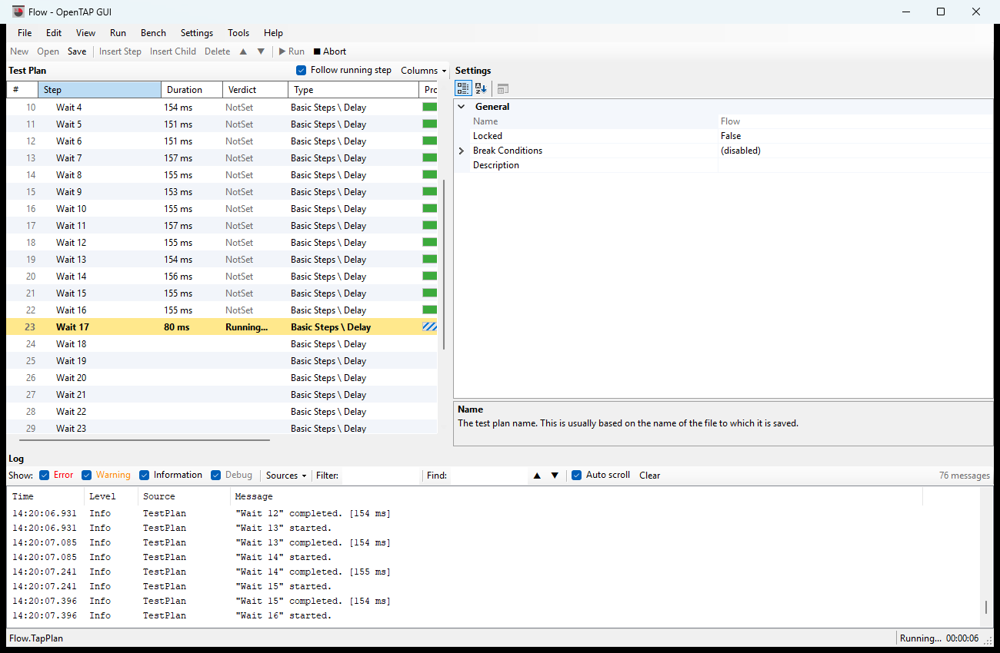
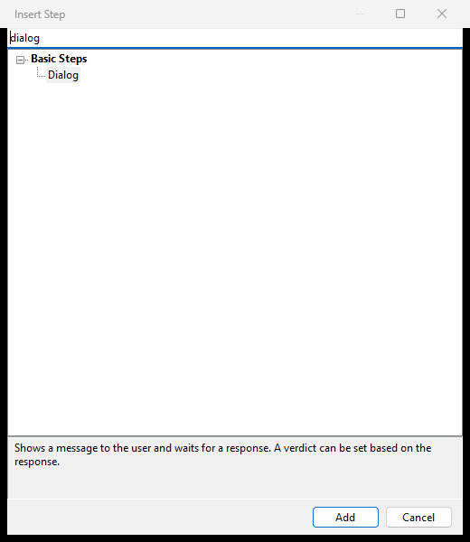
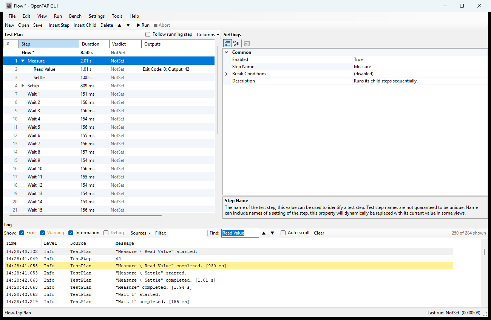
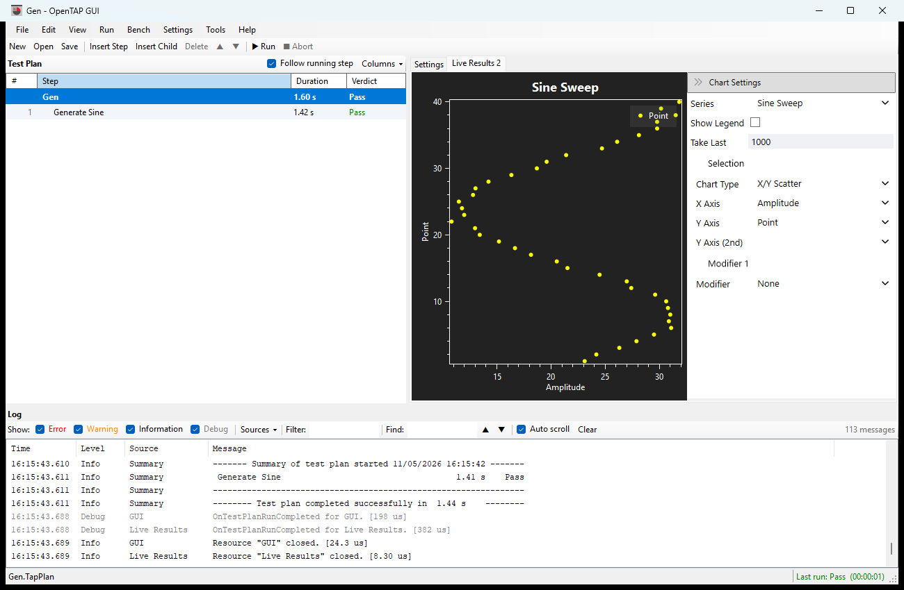
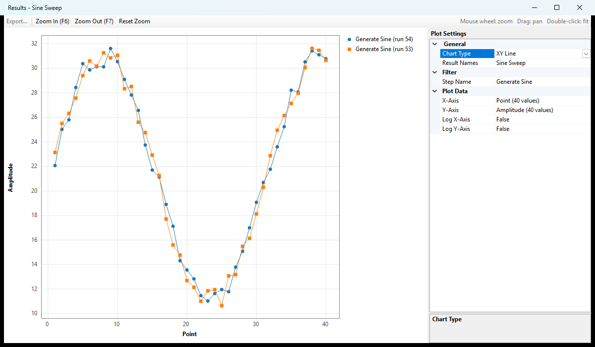

# OpenTAP GUI — User Manual & Tutorial

*A guide for new users of the OpenTAP GUI, the Windows desktop port of the OpenTAP TUI written by Claude (Anthropic's AI assistant).*

## Introduction

The OpenTAP GUI is a Windows program for building, editing and running OpenTAP test plans (`.TapPlan` files) and managing your test bench. It is a Windows desktop port of the OpenTAP TUI, written by Claude (Anthropic's AI assistant), and it runs inside OpenTAP itself, so every plugin, instrument, DUT and setting installed on your bench is available.

This guide is for people who are new to the GUI and possibly to OpenTAP. It has three parts:

- **Getting started and the tutorial** walk you through starting the program and building, running and checking your first test plan. Start here.
- **The manual sections** explain each part of the window in detail. Use them as a reference.
- **Shortcuts and troubleshooting** at the end answer the common "how do I" and "why doesn't" questions.

A few OpenTAP words you will meet throughout:

| Term | Meaning |
| --- | --- |
| Test plan | A list of test steps, saved as a `.TapPlan` file. |
| Test step | One action in a plan, such as a delay, a measurement or a dialog. Steps can contain child steps. |
| Settings | The values that control a step or the plan, shown in the Settings pane. |
| Verdict | The result of a step or run: Pass, Fail, Error, Inconclusive, Aborted or NotSet. |
| Bench | The instruments, DUTs (devices under test) and connections the plan uses. |
| Result listener | A plugin that stores or shows results, such as SQLite, CSV or Live Results. |

## Getting started

Double-click the **OpenTAP GUI** shortcut on your desktop; the main window opens in about 20 seconds while OpenTAP loads its plugins.

### What you need

- Windows with OpenTAP 9.33 or later installed in `C:\OpenTAP` (the bench runs 9.35.1).
- The **GUI** package installed in that OpenTAP. To install or update it, open a terminal in `C:\OpenTAP` and run `tap package install GUI.<version>.TapPackage`.

### Starting the GUI

| How | Command or action | Notes |
| --- | --- | --- |
| Desktop shortcut | Double-click **OpenTAP GUI** | Recommended. Starts in `C:\OpenTAP` and hides the console window. |
| Terminal | `tap gui` or `tap gui MyPlan.TapPlan` | Run from `C:\OpenTAP`. A plan name that does not exist yet is created empty. |
| Package manager only | `tap gui-pm` | Also in the GUI under **Tools**. |
| Results viewer only | `tap gui-results` | Also in the GUI under **Tools**. |

Always start the GUI from `C:\OpenTAP`. Some instrument plugins (for example the Riker switch matrix) read their configuration files from the folder OpenTAP was started in.

If the GUI closed unexpectedly last time while a plan had unsaved changes, it offers to recover them when it starts. Choose **Yes** to get your work back.

### A tour of the main window

The window has five areas, from top to bottom:

1. **Menu bar**: File, Edit, View, Run, then one menu per settings group (Bench, Settings and any your plugins add), Tools and Help.
2. **Toolbar**: New, Open, Save, Insert Step, Insert Child, Delete, Move up and down, Run (Continue when paused) and Abort.
3. **Test Plan pane** (left): the steps of the open plan, one row per step, with a number, name and optional columns such as Duration and Verdict.
4. **Settings pane** (right): the settings of whatever is selected on the left. Plugin panels such as the Operator Panel open as extra tabs here.
5. **Log** (bottom) and **status bar**: messages from OpenTAP and your steps; the status bar shows the plan's file and the run state (Ready, Running, Paused, Last run: Pass).

Drag the dividers between the panes to resize them. The GUI remembers the width of the Settings pane for next time.

Figure 1 below shows the main window while a plan runs: the running step is highlighted in yellow and finished steps show their duration and verdict.

*Figure 1. The main window during a run. Wait 17 is running (yellow); finished steps show duration, verdict and a full progress bar.*

## Tutorial: your first test plan

In about 15 minutes you will build a plan that waits, logs a message and asks the operator a question, run it, pause it at a breakpoint and look at the result. It uses only steps that come with OpenTAP, so it works on any bench and touches no instruments.

### Part 1: Build the plan

1. Choose **File > New** (Ctrl+N). The Test Plan pane shows one row, **Untitled**: that row is the plan itself.
2. Click **Insert Step** on the toolbar (Ctrl+I). In the dialog, type `delay` in the search box, select **Basic Steps > Delay** and click **Add**. Figure 2 shows this dialog.
3. With the new **Delay** row selected, look at the Settings pane on the right. Set **Time Delay** to `1 s` and **Step Name** to `Wait for power`. The step's name in the Test Plan pane changes as you type.
4. Click **Insert Step** again and add **Flow Control > Sequence**. Rename it `Measure`. A Sequence is a container: it runs the steps inside it in order.
5. With **Measure** selected, click **Insert Child** (Ctrl+Shift+I) and add **Basic Steps > Log Output**. Set **Log Message** to `Hello from my first plan`.
6. Select **Measure** again, click **Insert Child** and add **Basic Steps > Dialog**. Set:
   - **Title**: `Operator check`
   - **Message**: `Is the DUT connected?`
   - **If Yes/OK**: `Pass`
   - **If No/Cancel**: `Fail`
7. Choose **File > Save As** (Ctrl+Shift+S) and save the plan as `MyFirstPlan.TapPlan`. The `*` after the name in the title bar disappears once the plan is saved.

*Figure 2. The step picker. Typing in the search box filters the step types; the description of the selected step is shown at the bottom.*

Your plan now has 4 steps: Wait for power (1), Measure (2) with its children Log Output (3) and Dialog (4). Click the arrow next to **Measure** to fold or unfold its children.

### Part 2: Run it

1. Press **F5** or click **▶ Run**.
2. Watch the Test Plan pane: the running step is highlighted in yellow, its **Duration** counts up, and finished steps show their **Verdict**.
3. When the **Operator check** dialog appears, click **OK**.
4. The status bar now says **Last run: Pass**, and the log ends with a summary listing every step and its time.

### Part 3: Explore

1. **Add columns.** Click **Columns** above the Test Plan pane and tick **Type** and **Progress**. Drag a column header left or right to move the column.
2. **Set a breakpoint.** Select **Measure** and press **F9**. A red dot appears next to its number.
3. **Run to the breakpoint.** Press **F5**. After Wait for power, the run pauses: Measure turns orange and the status bar says **Paused at breakpoint**. Press **F5** (now **▶ Continue**) to carry on. Press F9 on Measure again to remove the breakpoint.
4. **Use the log.** Untick **Debug** in the log toolbar to hide detail messages. Type `Measure` in **Find** and press Enter to jump between matching lines.
5. **Reorder steps.** Drag **Log Output** below **Dialog**, or select it and press Alt+Down. The step numbers follow the new order.
6. **Reopen later.** Close the GUI (save when asked), start it again and choose **File > Recent Test Plans > MyFirstPlan.TapPlan**.

You have now used the main features. The sections below explain each one in more depth.

## The Test Plan pane

The Test Plan pane lists every step of the open plan as a tree with columns. The first row is the plan itself; select it to see the plan's own settings.

### Reading the rows

- **#**: the step's position in the whole plan. Numbers count every step, including those inside folded groups, so a step keeps its number when you fold or unfold. A red dot here marks a breakpoint.
- **Step**: the step's name, indented under its parent. Click the arrow, double-click the row, or press Right/Left to unfold or fold its children.
- Grey text means the step is disabled and will be skipped.
- Rows are shaded alternately to make long plans easier to follow.

### Selecting steps

Click a row to select it. Ctrl+click adds or removes single rows; Shift+click selects a range. With several steps selected, the Settings pane edits them all at once (only settings they share are shown).

### Adding, moving and removing steps

| Action | Toolbar or menu | Keys |
| --- | --- | --- |
| Insert a step after the selection | Insert Step | Ctrl+I |
| Insert a step inside the selection | Insert Child | Ctrl+Shift+I |
| Delete the selected steps | Delete | Del |
| Move a step up or down | ▲ / ▼ | Alt+Up / Alt+Down |
| Enable or disable | Edit > Enable / Disable | Space |
| Cut, copy, paste a step | Edit menu | Ctrl+X / Ctrl+C / Ctrl+V |
| Show the plan's settings | Edit > Test Plan Settings |  |
| Unfold or fold everything | View > Expand All / Collapse All |  |

The step picker lists every step type installed on your bench, grouped by category. Type in its search box to filter, then double-click a step or click **Add**. Insert Child is only available for steps that can hold children, such as Sequence.

You can also **drag** steps: drop on the upper or lower edge of a row to place them before or after it, or on the middle of a container step to put them inside. Right-click a step for a menu with the same commands.

### Columns

Click **Columns** above the pane to choose extra columns. Your choice and column order are remembered.

| Column | Shows |
| --- | --- |
| Duration | How long the step took; counts up while it runs. Shown by default. |
| Verdict | The step's verdict in the current or last run, coloured green or red. Shown by default. |
| Type | The kind of step, for example Basic Steps \\ Delay. |
| Progress | A bar: for a container, the share of its child steps finished; for other steps, the running time compared with the last run. |
| Outputs | The step's output values by name, for example Exit Code: 0. |
| Any setting | Right-click a setting in the Settings pane and choose **Show as Column in Test Plan**. |

Drag a column header to move the column. To remove a setting column, untick it under **Columns** or right-click the setting again.

### During a run

The running step is highlighted in yellow and bold. If it sits inside a folded group, the group's row is highlighted instead. With **Follow running step** ticked (above the pane), the view scrolls to keep the running step visible; untick it to scroll freely during a run. While a plan runs you cannot add, delete or move steps.

## The Settings pane

The Settings pane shows and edits the settings of whatever is selected in the Test Plan pane: one step, several steps, or the plan itself (the top row).

### Editing values

Settings are grouped under headings such as General and Common. Click a value to change it. The box at the bottom explains the selected setting. Changes apply straight away and mark the plan as unsaved (`*` in the title).

| You see | How to edit |
| --- | --- |
| Text or a number with a unit (`1 s`, `5 V`) | Type the new value and press Enter. |
| A drop-down arrow | Pick from the list, for example an instrument, a DUT or a verdict. |
| True / False | Double-click to toggle, or pick from the drop-down. |
| A row with a `>` arrow | Expand it: it holds sub-settings, or an Enabled check plus a value. |
| `(3 items)` and a `...` button | Click `...` to open a table where you add, remove and edit rows. |
| A `...` button on a file or folder setting | Click it to browse for the file or folder. |
| `Click ... to run` | The setting is an action; click `...` to run it. |
| Greyed-out value | Read-only, or turned off by another setting (for example Timeout when Use Timeout is False). |
| ⚠ after the name | The value is not valid; the reason is shown in the description box. |

Symbols before a setting's name: **○** an output, **●** an output used by another step, **→** an input fed from another step, **♦** parameterized (controlled from the plan or a parent).

### Right-click menu

Right-click a setting for its actions. The OpenTAP actions depend on the setting, for example **Parameterize On Test Plan** or **Assign Output**. The GUI adds:

- **Show '\<setting>' as Column in Test Plan**: adds the setting as a column in the Test Plan pane (choose it again to remove the column).
- **Jump to Source: \<step> → \<output>**: appears when the value comes from another step's output. It selects that step, unfolding its parents, and highlights the output when it is visible.

### Plan settings

Select the top row of the Test Plan pane (or **Edit > Test Plan Settings**) to see the plan's own settings, such as Locked, Break Conditions and Description. A locked plan cannot be edited until Locked is set back to False.

Tabs next to **Settings** at the top of this pane are plugin panels; see *Plugin panels* below.

## Running tests

Press **F5** to run the whole plan; results go to every result listener enabled under **Settings > Results**.

| To | Menu | Keys |
| --- | --- | --- |
| Run the whole plan | Run > Run Test Plan, or ▶ Run | F5 |
| Run only the selected steps | Run > Run Selected Steps, or right-click > Run Selected Steps | Ctrl+F5 |
| Stop a run | Run > Abort, or ■ Abort (asks to confirm) | Shift+F5 |
| Toggle a breakpoint | Run > Toggle Breakpoint, or right-click a step | F9 |
| Continue from a breakpoint | Run > Continue, or ▶ Continue | F5 |
| Remove all breakpoints | Run > Clear All Breakpoints |  |

### What you see during a run

- The running step is highlighted in yellow; Duration, Verdict and Progress update live.
- The status bar shows **Running...** with the elapsed time, then **Last run: \<verdict> (hh:mm:ss)** in green, red or orange.
- Editing commands (insert, delete, move, open another plan) are disabled until the run ends. You can still change settings.
- If **Clear on Run** is on in **Settings > GUI Settings**, the log is cleared at the start of each run.

### Breakpoints

A breakpoint pauses the run just **before** the step starts. The paused step turns orange, the status bar says **Paused at breakpoint: \<step>**, and the Run button becomes **▶ Continue**. While paused you can look at settings, the log and instruments; press F5 to continue or Shift+F5 to abort.

Breakpoints are marked by a red dot next to the step number. They last for the session, including when you reopen the same plan, but are not saved in the plan file.

### Questions from the plan

Steps such as Dialog, and some instruments, ask the operator a question during a run. The question appears as a normal Windows dialog with its buttons (for example OK and Cancel). Answer it to let the run continue; if the step has a timeout, the dialog closes by itself when it expires.

### Saving and recovery

Save with **Ctrl+S**. Until you do, the GUI keeps a recovery copy of your unsaved changes; if the GUI or PC stops unexpectedly, you are offered the changes back the next time the GUI starts. When you close the GUI or open another plan with unsaved changes, it asks whether to save them.

## The Log panel

The log at the bottom shows every message from OpenTAP, your steps and your instruments, newest at the bottom, coloured by level: errors red, warnings orange, information black, debug grey.

| Control | What it does |
| --- | --- |
| **Error / Warning / Information / Debug** check boxes | Show or hide messages of that level. Unticking Debug hides most of the detail. |
| **Sources** drop-down | Tick or untick message sources (TestPlan, Settings, your instrument names...). Show All and Hide All are at the top. The button says how many are hidden. |
| **Filter** box | Show only lines containing this text. Clear the box to see everything again. |
| **Find** box with ▲ ▼ | Highlights matching lines in yellow; Enter jumps to the next match, Shift+Enter to the previous. Finding turns Auto scroll off so the match stays in view. |
| **Auto scroll** | Keeps the newest line in view. Tick it again after reading back through the log. |
| **Clear** | Empties the log panel (OpenTAP's session log file is not affected). |
| Counter on the right | Total messages, or "N of M shown" while filtered. |

*Figure 3. Find highlights every matching line in yellow and selects the current match; Auto scroll has been turned off so the match stays in view.*

Select lines and press **Ctrl+C** (or right-click > Copy) to copy them; Ctrl+A selects all shown lines. The log keeps the last 100,000 messages; change this under **Settings > GUI Settings > Scrollback Limit**.

OpenTAP also writes everything to a session log file in `C:\OpenTAP\SessionLogs`, which is useful when sending a problem report.

## Bench and settings

The menus between Run and Tools hold OpenTAP's settings, one menu per settings group. **Bench** and **Settings** are always there; plugins can add more (for example **AI**).

| Menu item | What it holds |
| --- | --- |
| Bench > Instruments | Instrument definitions (power supplies, DMMs, switch matrices...), with addresses and options. |
| Bench > DUTs | The devices under test and their settings. |
| Bench > Connections | RF and other connections between instrument ports. |
| Bench > Profiles | Named sets of bench settings you can switch between. |
| Settings > Engine | OpenTAP engine options: session log path, break conditions, operator name, station. |
| Settings > Results | Result listeners: where results go (SQLite, CSV, PostgreSQL...). |
| Settings > GUI Settings | Log scrollback limit, Clear on Run, Follow Running Step. |

### Instruments, DUTs, connections and results

These open a two-part window: the list on the left, the selected item's settings on the right.

- **Add...** opens the picker of installed types (for example Generic SCPI Instrument); choose one and click **Add**.
- **Remove** (or Del) deletes the selected item after confirming.
- **▲ ▼** change the order.
- Edit settings on the right exactly as in the Settings pane.
- **Close** saves everything.

Steps refer to instruments and DUTs by name, so rename with care: steps that used the old name show a ⚠ until you pick the instrument again.

### Profiles

A profile is a complete set of bench settings stored in its own folder. Use profiles to switch between test stations or product variants.

- Click a profile in the list to make it active straight away.
- **New Profile...** creates an empty profile and makes it active.
- **Delete Profile** removes the active profile and its files after confirming (only when there is more than one).
- **Export Profile...** saves the active profile as a `.zip`; **Import Profile...** adds a profile from such a file.

### Other settings windows

Settings with a single page (Engine, GUI Settings and plugin settings) open in one window with all their settings. Changes are saved when you click **Close**.

## Plugin panels

Plugin panels are extra windows provided by installed OpenTAP packages; open them from **View > Panels**. On the bench these are AI Assist, Documentation, Live Results 1–4, OpenECU Operator Panel and Operator Panel.

### Opening, floating and docking

1. Choose **View > Panels > \<panel>**. It opens as a tab next to **Settings** in the right-hand pane. A tick in the menu shows it is open; choose it again to close it.
2. To give a panel its own window, **double-click its tab** or right-click the tab and choose **Float**. Move and resize the window anywhere, including on a second monitor.
3. To put it back, click **Dock next to Settings** at the top of the floating window. Closing the floating window closes the panel.
4. Right-click a tab > **Close** also closes a docked panel.

Open panels, and whether each was docked or floating, come back the next time you start the GUI.

### The panels on the bench

| Panel | Use |
| --- | --- |
| Operator Panel | A simple run screen for operators: a large start button, the plan's status (Idle, Running, Pass or Fail, in colour) and elapsed time. It runs the plan in its own session, so the Test Plan pane does not highlight steps during these runs. |
| OpenECU Operator Panel | The OpenECU project's operator screen. |
| Live Results 1–4 | Live charts of results as they are published, including runs started with F5 in the GUI. Choose the series and X/Y columns under Chart Settings. Live Results 1 needs the Keysight Editor licence. |
| Documentation | Browse the documentation of installed packages, with search and zoom. |
| AI Assist | Keysight's AI chat assistant for test plans. |

*Figure 4. Live Results 2 docked next to Settings, plotting the results of a run started with F5.*

The Keysight Editor's own window parts (its Test Plan, Test Steps, Test Step Settings, Test Plan Settings, Log and Welcome panels) are not listed: they only work inside the Editor, and the GUI has its own versions of them.

If a panel cannot run outside the Keysight Editor, the GUI closes it and shows a message explaining why, instead of crashing.

## Tools: package manager and results viewer

The **Tools** menu opens two windows that work alongside the main window; each can also be started on its own with `tap gui-pm` or `tap gui-results`.

### Package Manager

Use it to see what is installed and to install, update or remove OpenTAP packages.

1. **Tools > Package Manager**. The list loads from the repositories **set in the package manager window's own Settings menu** (packages.opentap.io by default); installed packages are listed first, in green. A moment later, installed packages with a newer release for your system are highlighted in orange with the new version, for example *OpenTAP (installed, update available: 9.35.3)*, and the heading above the list says how many updates there are.
2. Type in **Search packages** to narrow the list, then click a package to see its details: version, owner, compatibility and description with links.
3. Click **Install / Uninstall...** (or double-click the package). The version window lists every version available for your OpenTAP, newest first, with the installed one marked.
4. Select a version and click **Install**, or click **Uninstall** on the installed version. A progress bar and the log show what happens; **Cancel** stops it.

Close the GUI and start it again after installing or removing packages so OpenTAP loads the change. Installing changes the whole bench: check with whoever manages it first.

### Results Viewer

The results viewer reads runs from the result stores set under **Settings > Results** (for example SQLite or PostgreSQL), or from a results file you open. It has three parts.

**Database** (toolbar). Choose where the runs come from:

- **All result stores** reads every store under Settings > Results.
- A store's name (for example **PostgreSQL** or **SQLite**) reads only that store.
- **Open TapResults file...** opens a `.TapResults` file (or another SQLite results database) from anywhere, for example one copied from another bench. The last 5 files you opened are listed for quick access.

Your choice is remembered for next time. If a database cannot be read (for example a PostgreSQL server that needs a password), the reason is shown in red in the status bar. Opening files needs the *SQLite and PostgreSQL* package.

**Run list** (top). One row per test plan run, with Run ID, name, verdict, start time, result names and source. **Refresh** reads the stores again; **Result Settings...** opens the result listener settings.

**Step Results** (bottom). Select one or more runs to list every step with its verdict, result values, Min and Max limits and Check Limits.

- Failed steps are shaded red.
- When Check Limits is True, values outside the limits are marked red.
- Click a column header to sort (numbers sort as numbers); sorting by Verdict brings failures to the top.
- Select rows and press Ctrl+C to paste them into Excel with their headers.

**Plots.** Tick the box of one or more runs and click **Plot Results** (F5). The plot window has a chart and **Plot Settings**:

| Setting | Choose |
| --- | --- |
| Chart Type | XY Scatter, XY Line or Column. |
| Result Names | Which result tables to plot. |
| Step Name (Filter) | Only results from these steps. |
| X-Axis, Y-Axis | Which columns to plot; \[Index\] is the row number. Text columns that hold numbers can be plotted. |
| Log X-Axis, Log Y-Axis | Logarithmic axes. |

*Figure 5. Two runs of the same plan compared as XY Line, with Point on the X axis and Amplitude on the Y axis.*

In the chart, the mouse wheel zooms, dragging pans and double-clicking fits all the data; hover over a point to see its values. **Export...** saves the plotted values with an exporter plugin such as CSV.

## Keyboard shortcuts

| Keys | Action | Where |
| --- | --- | --- |
| Ctrl+N | New test plan | Anywhere |
| Ctrl+O | Open a test plan | Anywhere |
| Ctrl+S | Save | Anywhere |
| Ctrl+Shift+S | Save As | Anywhere |
| Ctrl+I | Insert a step after the selection | Anywhere |
| Ctrl+Shift+I | Insert a child step | Anywhere |
| F5 | Run the plan, or Continue when paused | Anywhere |
| Ctrl+F5 | Run only the selected steps | Anywhere |
| Shift+F5 | Abort the run | Anywhere |
| F9 | Toggle a breakpoint on the selected steps | Anywhere |
| Del | Delete the selected steps | Test Plan pane |
| Ctrl+X / Ctrl+C / Ctrl+V | Cut / copy / paste a step | Test Plan pane |
| Alt+Up / Alt+Down | Move the step up / down | Test Plan pane |
| Space | Enable or disable the selected steps | Test Plan pane |
| Right / Left | Unfold / fold a step, or go to its parent | Test Plan pane |
| Enter | Jump to the Settings pane | Test Plan pane |
| Ctrl+C / Ctrl+A | Copy / select all lines | Log, step results |
| Enter / Shift+Enter | Next / previous match | Log Find box |
| F5 | Plot the ticked runs | Results viewer |
| F6 / F7 | Zoom in / out | Results plot |
| Ctrl+E | Export plotted values | Results plot |
| F5 | Refresh the package list | Package manager |

## Troubleshooting and FAQ

**The GUI takes a while to open.** OpenTAP loads every installed plugin at start-up; 20–30 seconds is normal on the bench. Closing also takes a few seconds while plugins shut down.

**An instrument reports "Could not find file ... .CSV" or similar.** The GUI was started from another folder. Start it with the desktop shortcut, or run `tap gui` from `C:\OpenTAP`.

**A step shows ⚠ or the run stops with an error about a setting.** Select the step and look for ⚠ in the Settings pane; the description box says what is wrong (often a missing instrument or an empty file path).

**I can't add or move steps.** A plan is running (wait or abort it), or the plan is locked: select the top row and set **Locked** to False.

**Run stopped at a step for no reason.** A breakpoint is set there (red dot by the number). Press F5 to continue, F9 on the step to remove it, or Run > Clear All Breakpoints.

**The view keeps jumping during a run.** Untick **Follow running step** above the Test Plan pane.

**I can't find a message in the log.** Check that its level is ticked, that its source is not hidden under **Sources**, and that the **Filter** box is empty. Tick **Auto scroll** to go back to the newest lines.

**A panel shows an error and closes.** Some panels are written for the Keysight Editor and only work inside it. Note the message and use the panel in the Editor instead.

**The Results Viewer shows no runs.** It needs a result store such as SQLite under **Settings > Results**, and it shows only runs saved there. Click **Result Settings...** to add one, then **Refresh**.

**A plot shows nothing.** Choose the X-Axis and Y-Axis under Plot Settings; columns marked \[Unsupported Type\] cannot be plotted.

**The GUI closed unexpectedly.** Start it again and choose **Yes** when it offers to recover unsaved changes. Send the newest file from `C:\OpenTAP\SessionLogs` with a description of what you were doing.

**Where can I learn more?** **Help > OpenTAP Documentation** opens the OpenTAP documentation, and **View > Panels > Documentation** browses the help of installed packages. The GUI's technical notes are in `OpenTAP.GUI/README.md` in its source folder.
